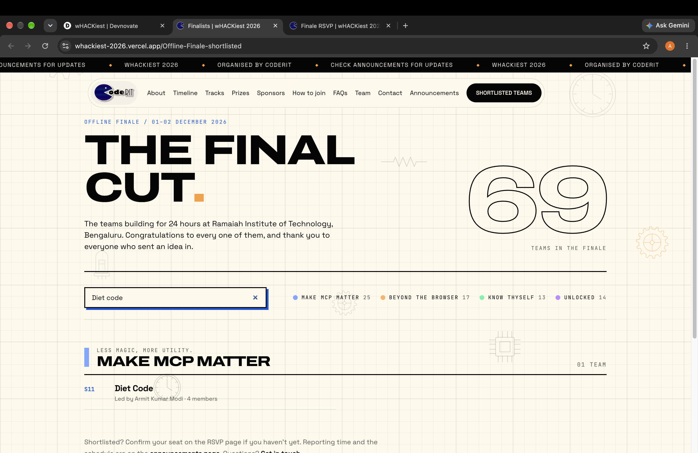

# ClaimBack MCP

An MCP-powered health insurance claims auditor and human-approved appeal assistant for Indian families.

[](https://github.com/armit26/DietCode-ClaimBack-MCP)
[-15803D?style=flat-square)](https://whackiest-2026.vercel.app/Offline-Finale-shortlisted)
[](https://github.com/armit26/DietCode-ClaimBack-MCP)

**Team Diet Code** · Built for **wHACKiest 2026** (Track 1: *Make MCP Matter — Less Magic, More Utility*)

---

## wHACKiest 2026 Offline Finale

**Selected as 1 of the 69 teams** (out of 4,139 participants / ~1,200 teams, and 1 of 25 teams in *Make MCP Matter*) to compete in the 24-hour Offline Finale at **wHACKiest 2026**, Ramaiah Institute of Technology, Bengaluru (Dec 1–2, 2026).

* **Shortlist Slot:** `S11` — Team Diet Code 
* **Official Shortlist:** [whackiest-2026.vercel.app/Offline-Finale-shortlisted](https://whackiest-2026.vercel.app/Offline-Finale-shortlisted)

<p align="center">
  
</p>

---

## The Problem

During a medical emergency, families are rarely in a state to cross-check a 40-page policy document against a 12-page hospital bill and a rejection email scattered across Gmail and Drive. Under pressure at the billing desk, most people end up absorbing unfair rejections and duplicate charges out of pocket.

* **58 Crore+** insured Indians filing **3.26 Crore+ health claims/year** *(IRDAI)*
* **2.97 Lakh** grievances logged on IRDAI's *Bima Bharosa* portal in FY26 alone, up from 2.58L in FY25 (~69% claim disputes — *Finance Ministry / IRDAI*)
* **₹2 Crore** fine levied by IRDAI on Star Health in Nov 2026 for unjustified claim rejections and unsupported deductions

Existing alternatives fall short: *Bima Bharosa* is only a filing portal (no bill audit or deadline tracking), third-party claim agents take a **10–15% payout cut**, and generic AI chatbots hallucinate insurance regulations while lacking controlled access to actual family records.

---

## How ClaimBack MCP Works

ClaimBack MCP connects a family's everyday apps via **Model Context Protocol (MCP)** using strict read-only and draft-only scopes. Instead of letting an LLM guess the law, messy policy/bill text is structured after local PII redaction and verified against **deterministic Python rules** codified from IRDAI's May and September 2024 Master Circulars.

### Registered FastMCP Tools (`mcp_server/server.py`)

1. **`drive_policy_fetcher`** (`drive.readonly`) — Pulls policy metadata and multi-year continuous renewal history from Google Drive to verify moratorium eligibility.
2. **`irdai_rule_auditor`** (`local.deterministic`) — Audits the claim against 5 codified IRDAI 2024 rules and runs `RapidFuzz` token-sort matching to flag duplicate hospital bill line items.
3. **`gmail_draft_escalator`** (`gmail.compose`, draft-only) — Prepares an editable Grievance Redressal Officer (GRO) appeal draft. Hard-blocked (`BLOCKED_BY_HITL_GATE`) until explicit human approval—zero autonomous sending.
4. **`calendar_sla_tracker`** (`calendar.events`) — Schedules statutory escalation clocks: 3-hour hospital discharge cap, 14-day insurer grievance resolution deadline, and 30-day Insurance Ombudsman eligibility.

### IRDAI 2024 Rules Verified (`rules/irdai_2024_rules.json`)

| Rule ID | Mandate | Regulatory Reference |
| :--- | :--- | :--- |
| `IRDAI_CASHLESS_1HR` | Initial cashless decision within **1 hour** of request | Sep 2024 Circular, Sec I, Part B, V.3(i), 1(i) |
| `IRDAI_DISCHARGE_3HR` | Final discharge authorization within **3 hours** (extra stay cost borne by insurer from shareholders' funds) | Sep 2024 Circular, Sec I, Part B, V.3(i), 2(i)–(ii) |
| `IRDAI_REIMBURSEMENT_15D` | Non-cashless settlement within **15 days** of submission; delays attract **bank rate + 2% interest** paid *suo motu* from intimation | Sep 2024 Circular, Sec I, Part B, V.2(ii) & V.3(iii)(6) |
| `IRDAI_MORATORIUM_60M` | After **60 continuous months** (including ported/migrated credits), non-disclosure/misrepresentation contestability is barred except **established fraud** *(applies to initial sum insured; separate 60-mo clock on enhancements; permanent exclusions remain separate)* | IRDAI (Insurance Products) Regs 2024, Sch. III, Para 8 & May 2024 Circular, Ch. I, Para 13 |
| `IRDAI_PMC_CRC_REPUDIATION` | No repudiation without **PMC** or 3-member **CRC** approval; rejections and partial disallowances must cite specific policy clauses in writing | Sep 2024 Circular, Sec I, Part B, V.3(iii) & May 2024 Circular, Ch. I, Para 17 |
| Duplicate Bill Audit | `RapidFuzz` token-sort ratio catches repeated or slightly reworded hospital consumables billed on the same date | Itemized bill verification |

> **Escalation note:** Policyholders can file with the insurer's GRO or directly on IRDAI's *Bima Bharosa* portal anytime (14-day insurer resolution SLA), and approach the Insurance Ombudsman (claims up to ₹50 Lakh) if unresolved after 30 days or resolved unsatisfactorily.

---

## Architecture

```text
[1. CLIENT & OAUTH]              [2. BACKEND & IRDAI ENGINE]            [3. HITL GATE & VOICE]           [4. SCOPED MCP OUTPUTS]
Tailwind UI · Google OAuth       FastAPI · FastMCP (AWS Lambda)         ZERO AUTO-SEND                   Everyday Apps
┌─────────────────────────┐      ┌────────────────────────────────┐     ┌─────────────────────────┐      ┌─────────────────────────┐
│ • Upload hospital bill  │HTTPS │ • AWS Textract + PyMuPDF OCR   │Audit│ • Red/Green clause diff │Human │ • Gmail MCP:            │
│ • Sync rejection email  ├─────►│ • Presidio Local PII Masking   ├────►│ • 1-Click Human Approve │Appr. │   Editable GRO draft    │
│ • Sync 6-yr Drive PDFs  │+PDFs │ • Claude API + Pydantic JSON   │Rpt. │ • ElevenLabs Voice      ├─────►│ • Calendar MCP:         │
│ • Live What-If tester   │      │ • 5 IRDAI Rules + RapidFuzz    │     │   Brief (EN · HI · KN)  │      │   3-hr, 14-d & 30-d SLA │
└─────────────────────────┘      └───────────────┬────────────────┘     └────────────┬────────────┘      │ • PDF Dossier:          │
                                                 │ Store                             │ Log               │   Bima Bharosa/Ombuds.  │
                                                 ▼                                   ▼                   └────────────┬────────────┘
                           ┌──────────────────────────────────────────────────────────────────────────────────────────┴───┐
                           │        ENCRYPTED STORAGE & AUDIT LOGS (DPDP ACT ALIGNED)                                     │
                           │   AWS S3 (SSE-KMS PDFs)  ·  AWS DynamoDB (Approval Trail)  ·  1-Click User Delete            │
                           └──────────────────────────────────────────────────────────────────────────────────────────────┘
```

---

## Running Locally

```bash
git clone [https://github.com/armit26/DietCode-ClaimBack-MCP.git](https://github.com/armit26/DietCode-ClaimBack-MCP.git)
cd DietCode-ClaimBack-MCP

python3 -m venv .venv
source .venv/bin/activate        # Windows: .venv\Scripts\activate
pip install -r requirements.txt

# 1. Start the interactive web prototype (FastAPI + live Audit Card & What-If simulator)
uvicorn api:app --reload
# Open [http://127.0.0.1:8000](http://127.0.0.1:8000)

# 2. Run the standalone CLI audit + HITL approval demo
python demo_run.py

# 3. Run the 4-tool Python FastMCP server
python -m mcp_server.server
```

---

## Tech Stack

| Layer | Tools | Role |
| :--- | :--- | :--- |
| **Frontend** | Tailwind CSS (Live Prototype) · Next.js (Prod) | Responsive audit card, live What-If simulator, and approval UI |
| **MCP Layer** | Python `FastMCP` SDK + Google OAuth 2.0 | Standardized read/draft-only tool bridge to Drive, Gmail, and Calendar |
| **Backend & Cloud** | FastAPI (Python) · AWS Lambda + API Gateway | Hosts MCP tools and REST bridge |
| **Document Audit** | AWS Textract · PyMuPDF · `RapidFuzz` | Multi-column bill parsing and fuzzy duplicate charge detection |
| **Rules & Structuring** | Claude API · Pydantic · JSON Rulebook | LLM handles text structuring; pure Python enforces IRDAI 2024 rules |
| **Voice Co-Pilot** | ElevenLabs Multilingual v2 (with offline Web-Speech fallback) | Spoken 30s rights briefs in English, Hindi, and Kannada |
| **Privacy & Storage** | Microsoft Presidio · AWS S3 (SSE-KMS) · DynamoDB | Local PII redaction before LLM calls, encrypted storage, and 1-click delete |

---

## Repository Structure

```text
├── assets/
│   └── final-cut.png              # wHACKiest 2026 Offline Finale shortlist
├── frontend/
│   └── index.html                 # Interactive Audit Card, What-If simulator & HITL UI
├── rules/
│   └── irdai_2024_rules.json      # Codified IRDAI May & Sep 2024 rules + citations
├── mcp_server/
│   ├── __init__.py
│   ├── auditor.py                 # Deterministic 5-rule engine + RapidFuzz bill audit
│   └── server.py                  # Python FastMCP server exposing 4 scoped tools
├── sample_data/
│   └── case_cb_204.json           # Synthetic test case (72-mo moratorium + ₹8,600 dupes)
├── api.py                         # FastAPI bridge connecting UI to FastMCP & auditor.py
├── demo_run.py                    # CLI prototype with HITL gate
├── requirements.txt
├── .gitignore
└── README.md
```

### Roadmap

- [x] **Round 1 & Online Ideathon:** Codified IRDAI 2024 ruleset, 4-tool Python `FastMCP` server, `RapidFuzz` duplicate bill detector, local PII masking preview, and interactive web prototype with HITL gate
- [ ] **24-Hr Offline Finale (Dec 1–2 @ RIT):** Live Google OAuth (`drive.readonly`, `gmail.compose`, `calendar.events`), live hospital bill PDF upload with OCR/Textract, live ElevenLabs Multilingual v2 audio streaming, and 1-click Ombudsman PDF dossier export

---

## Privacy & Disclaimer

* **Human-in-the-Loop (HITL):** Gmail integration is restricted to editable drafts only—ClaimBack MCP never sends emails autonomously.
* **DPDP Act Aligned:** Patient names and policy IDs are redacted locally before LLM structuring, with encrypted storage and 1-click user deletion planned for production.
* **Not Legal Advice:** ClaimBack MCP is a clause-backed claim audit and appeal-drafting assistant, not formal legal counsel. Final escalation decisions stay with the policyholder.

---

**Team Diet Code**